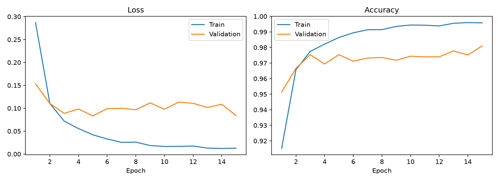
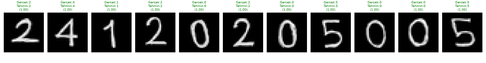

# MNIST ile MLP Tabanlı El Yazısı Rakam Tanıma

**Ad Soyad:** Zeynep Tuğba Kurt
**Öğrenci No:** 24120205005

## 1. Kurulum ve Çalıştırma

```bash
python3 -m venv venv
source venv/bin/activate          # Windows: venv\Scripts\activate
pip install -r requirements.txt

python train.py                   # Deney 1: eğitim, grafikler, results_exp1.json, mlp_exp1.pt
python predict_own.py             # my_digits/ klasöründeki tek tek rakamları tahmin eder
python predict_own.py --full numara.png --label 24120205005   # tek görselden numara tahmini
```

Not: `mlp_exp1.pt` repoda hazır olduğu için `predict_own.py`, `train.py` çalıştırılmadan da çalışır.
Kullanılan Python sürümü: 3.13, kütüphane: PyTorch (CNN ve hazır eğitilmiş model kullanılmamıştır).

## 2. Veri Seti ve Ayrım

- MNIST: 28×28 gri seviyeli, 10 sınıf (0–9).
- 60.000 eğitim görüntüsü → **55.000 train + 5.000 validation** (seed=42 ile rastgele ayrıldı).
- 10.000 görüntülük resmi test seti → **yalnızca eğitim tamamen bittikten sonra bir kez** kullanıldı; model geliştirme sırasında kullanılmadı.
- Normalizasyon: ortalama 0.1307, standart sapma 0.3081.

## 3. Model ve Hiperparametreler

Mimari: `784 → 256 → ReLU → 128 → ReLU → 10` (Flatten + 3 Linear katman, 2 hidden layer)

| Parametre | Değer |
|---|---|
| Hidden layer boyutları | 256, 128 |
| Aktivasyon | ReLU |
| Loss | CrossEntropyLoss |
| Optimizer | Adam |
| Learning rate | 0.001 |
| Batch size | 128 |
| Epoch | 15 |
| Validation boyutu | 5000 |
| Random seed | 42 |
| Cihaz | CPU |

## 4. Deney 1 Sonuçları

| Metrik | Değer |
|---|---|
| Training loss | 0.0129 |
| Validation loss | 0.0840 |
| Training accuracy | %99.58 |
| Validation accuracy | %98.10 |
| **Test accuracy** | **%98.00** |
| Test loss | 0.0848 |
| Eğitim süresi | ≈ 40.8 sn |

(Ham değerler: `results_exp1.json`)

### Eğitim grafikleri



## 5. Kendi El Yazım

Öğrenci numaram **24120205005**'i beyaz kağıda siyah kalemle, rakamlar birbirine değmeyecek şekilde yazıp tek bir fotoğraf olarak çektim (`numara.png`). İlk denememde ince uçlu bir kalem kullanmıştım; çizgiler MNIST'e göre çok ince olduğu için kalın uçlu kalemle yeniden yazdım ve bu son görseli kullandım. Rakamlar iki şekilde test edildi:

1. **Tek tek:** `numara.png` içinden ayrılan her rakam `my_digits/` klasörüne `<sıra>_<rakam>.png` olarak kaydedildi ve ayrı ayrı tahmin edildi.
2. **Tek görsel:** Tüm numara tek görsel olarak verildi, rakamlar kod tarafından otomatik bölünüp tahmin edildi.

**Ön işleme adımları (`predict_own.py`):**
1. Gri tonlamaya çevirme
2. Zemin açıksa renkleri ters çevirme (MNIST: siyah zemin, beyaz rakam)
3. Zemin seviyesini sıfırlama, düşük yoğunluklu gürültüyü temizleme
4. (Tek görsel modunda) yazı satırını bulup satır dışındaki leke/kıvrımları atma, rakamları dikey boşluklara göre soldan sağa ayırma
5. Rakamın sınırlayıcı kutusuna kırpma
6. En-boy oranını koruyarak en uzun kenarı 20 piksele küçültme, 28×28 tuvale kütle merkezine göre ortalama
7. MNIST ortalaması ve standart sapması ile normalizasyon

**Sonuçlar:**

| Yöntem | Gerçek numara | Tahmin | Rakam bazlı doğruluk |
|---|---|---|---|
| Tek tek rakam görselleri | 24120205005 | 24120205005 | %100 (11/11) |
| Tek görselden otomatik bölme | 24120205005 | 24120205005 | %100 (11/11) |

Tek tek modda modelin güven (softmax olasılığı) değerleri: 2→1.000, 4→1.000, 1→0.998, 2→1.000, 0→0.996, 2→1.000, 0→1.000, 5→1.000, 0→1.000, 0→1.000, 5→1.000. En düşük güven 0.996 ile 5. sıradaki "0" rakamında, ardından 0.998 ile "1" rakamında görüldü.




## 6. Genel Değerlendirme

**Eğitim süreci.** Train loss 15 epoch boyunca 0.287'den 0.013'e düzenli olarak düştü, train doğruluğu %91.5'ten %99.6'ya çıktı. Validation loss ise ilk 3–5 epoch'ta hızla düşüp (en düşük ≈ 0.083, 5. epoch) sonrasında 0.08–0.11 arasında dalgalanmaya başladı, belirgin biçimde düşmeye devam etmedi.

**Overfitting.** Train doğruluğu (%99.58) ile validation doğruluğu (%98.10) arasındaki fark ve train loss'un çok düşük, validation loss'un ise sabit kalması, modelin eğitim verisini kısmen ezberlemeye başladığını gösteriyor. Fark büyük olmadığı için overfitting hafif düzeydedir. Dropout, weight decay, early stopping veya daha az epoch gibi yöntemlerle azaltılabilir.

**Genelleme.** Validation (%98.10) ve test (%98.00) doğruluğu birbirine çok yakın. Bu, modelin daha önce görmediği verilerde tutarlı çalıştığını ve test verisinin geliştirme sürecine karışmadığını destekliyor.

**Kendi el yazım.** Hem tek tek hem de tek görselden otomatik bölmeyle 11 rakamın 11'i doğru tahmin edildi (%100) ve güven değerleri 0.996–1.000 arasında kaldı. MNIST test doğruluğu %98 olduğu halde kendi yazımda hata görmemem, ön işlemenin rakamları MNIST formatına iyi yaklaştırmasıyla (renk tersleme, kırpma, 20 piksele ölçekleme, kütle merkezine ortalama) ve yazımın kalın, net, eğimsiz ve birbirinden ayrık olmasıyla açıklanabilir. İlk denememde kalem ince olduğu için rakamlar MNIST'teki çizgi kalınlığından belirgin şekilde farklıydı; bu yüzden kalın kalemle tekrar yazdım. Bu, modelin başarısının yazının MNIST'e benzerliğine bağlı olduğunu gösteriyor.

İki yöntem aynı fotoğraftan türetildiği için aynı sonucu vermesi beklenen bir durumdur ve birbirinden bağımsız iki doğrulama sayılmaz. Ayrıca 11 rakamlık tek bir örnek küçük olduğundan %100 sonucu genellenemez: MLP piksellerin konumuna duyarlı olduğu için rakam ortalanmasa, eğik veya farklı kalınlıkta yazılsa, ya da ışık/gölge farklı olsa başarının düşmesi beklenebilir. Daha güvenilir bir değerlendirme için farklı kalem, kağıt ve yazış biçimleriyle daha fazla örnek toplamak gerekir.

**Olası iyileştirmeler.** Dropout ekleme, veri artırma (kaydırma/döndürme), farklı hidden layer boyutları, learning rate ve batch size denemeleri, kendi el yazısıyla ek örnekler toplayıp modeli geliştirme.

## 7. Dosya Yapısı

```
├── train.py                    # Deney 1 eğitim kodu
├── predict_own.py              # El yazısı ön işleme ve tahmin
├── requirements.txt
├── results_exp1.json           # Deney sonuçları
├── training_curves_exp1.png    # Loss/accuracy grafikleri
├── mlp_exp1.pt                 # Eğitilmiş model ağırlıkları
├── my_digits/                  # Tek tek el yazısı rakam görselleri
├── numara.png                  # Tüm numaranın tek görseli
├── own_digits_predictions.png
└── full_number_predictions.png
```